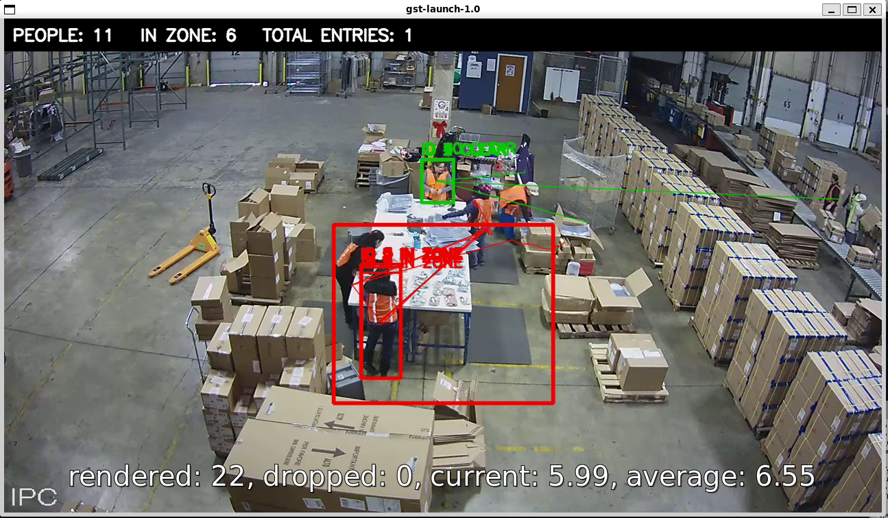
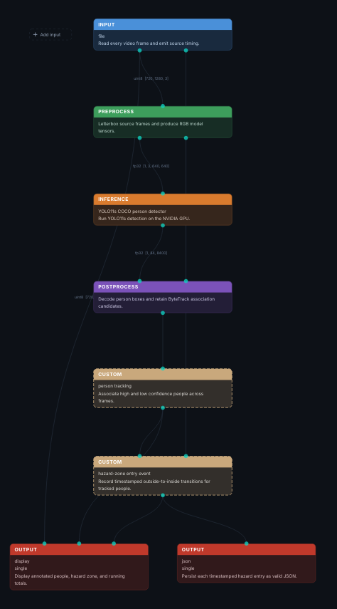

# Workplace Safety Sentinel

## Project overview
Workplace Safety Sentinel is a video-based workplace safety monitoring pipeline built with PipeGen. It detects people in a warehouse video, classifies detections relative to a configured hazard-zone polygon, tracks detections, and exports frame-level metadata as JSON.

## Objective
Demonstrate a Physical AI perception pipeline that can identify people in a restricted area and expose machine-readable outputs for safety monitoring.

## Pipeline
- Input: warehouse video file
- Detection model: YOLO11s ONNX
- Inference engine: TensorRT FP16
- Tracking and zone logic: PipeGen RestrictedAreaMonitoring workflow
- Outputs: live annotated video and JSON metadata

## Pipeline running



## Pipeline IR node graph



## How to Run

### Requirements
- NVIDIA GPU with compatible NVIDIA drivers
- Docker and NVIDIA Container Toolkit
- Linux environment with GPU access

### Run the exported pipeline
From the extracted `pipegen-workplace-hazard-zone-sentinel` directory, run:

```bash
./run.sh --input ~/warehouse.mp4 --headless --output ~/videos/export_test
```

The launcher prepares the pipeline and TensorRT engine if needed, then processes the input video.

### Output files
- `~/videos/export_test/output.mp4` — processed video
- `~/videos/export_test/metadata.json` — frame-level JSON metadata

### Verified environment
Tested on Ubuntu 24.04 under WSL2 with an NVIDIA GeForce RTX 2050 Laptop GPU, using the exported TensorRT FP16 engine.

### Limitations
The cumulative zone-entry counter and detections have not been independently validated against ground truth. This is a prototype, not a production safety-alert system.

## Hardware and performance
- GPU: NVIDIA GeForce RTX 2050 Laptop GPU, 4 GB VRAM
- TensorRT engine: yolo11s.fp16.plan
- Engine size: approximately 27 MB
- Reported benchmark: approximately 111 FPS and 8.996 ms latency
- Benchmark power reading: approximately 31.44 W

Performance values are from the PipeGen benchmark run on the development machine and may vary with workload and environment.

## Results
The saved metadata contains 102 frames, of which 101 have detections. The summary reports a maximum of 29 people detected in one frame and a maximum of 28 classified inside the zone. The final cumulative entry counter is 29.

## Important limitation
The cumulative entry counter has not been independently validated as a count of unique people or confirmed safety incidents. Inspection found overlapping/near-duplicate detections in some frames, and the saved metadata did not expose separately labelled entry or intrusion event records. These results should therefore be treated as pipeline demonstration metrics, not verified incident statistics.

## Reproducibility
The project directory contains the PipeGen Pipeline IR and requirement/state files, generated DeepStream scripts, application source, model-stage artifacts, TensorRT engine, and exported JSON results. The TensorRT engine may be specific to the GPU and software versions used to build it.

## Suggested next improvements
1. Tune detection confidence and non-maximum suppression to reduce duplicate detections.
2. Validate tracker identity stability across consecutive frames.
3. Confirm zone-entry logic against manually reviewed video timestamps.
4. Export a dedicated event record with timestamp, track ID, and zone identifier for each validated entry.
5. Test on additional footage and report precision/recall against labelled examples.
